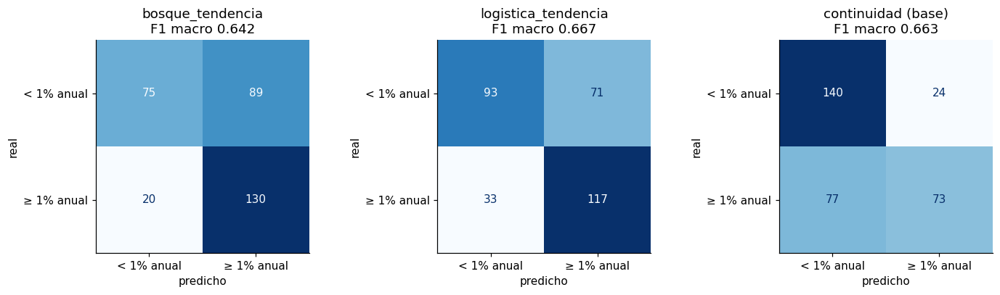

# Clasificación del crecimiento poblacional comunal en Chile

Proyecto semestral de Ingeniería de Datos. Técnica asignada: **clasificación**.

**Pregunta:** a partir de lo que se sabe de una comuna al inicio de un período intercensal (su tamaño, su estructura de edades y cuánto creció antes), ¿se puede clasificar si crecerá **al menos 1% anual** en el período siguiente?

- Clase 1: tasa anual ≥ 1% (*crecimiento alto*).
- Clase 0: tasa anual < 1% (estancamiento o declive).
- Tasa anual = (P_final / P_inicial)^(1/años) − 1.

## Entregables

| | Archivo |
|---|---|
| Análisis exploratorio | [`notebooks/01_analisis_exploratorio.ipynb`](notebooks/01_analisis_exploratorio.ipynb) |
| Experimento comparativo | [`notebooks/02_experimento_clasificacion.ipynb`](notebooks/02_experimento_clasificacion.ipynb) |
| Figuras de la entrega | [`results/entrega/`](results/entrega/) |

Los notebooks se guardaron ya ejecutados, con todas sus salidas visibles.

## Datos

Tabulados oficiales del **INE** (Instituto Nacional de Estadísticas de Chile), con licencia CC BY-SA 4.0. Ver [`docs/licencia_datos.md`](docs/licencia_datos.md).

| Censo | Fuente | Archivo |
|---|---|---|
| 1992, 2002, 2017 | REDATAM INE: población por comuna y grupo de edad | `data/raw/ine/crecimiento/edad_residencia_*.html` |
| 2017 | Residentes habituales por comuna (contraste independiente) | `data/raw/ine/crecimiento/residentes_2017.xlsx` |
| 2024 | Resultados oficiales del Censo 2024 | `data/raw/ine/crecimiento/poblacion_2024.xlsx` |

- Los archivos crudos **están incluidos en el repositorio**. El manifiesto [`data/raw/ine/crecimiento/fuentes.json`](data/raw/ine/crecimiento/fuentes.json) registra para cada uno la URL, los parámetros de consulta, la fecha de descarga y el hash SHA-256.
- La tabla integrada que usan los notebooks es [`results/crecimiento_v2/perfiles_censales.csv`](results/crecimiento_v2/perfiles_censales.csv): 316 comunas × 4 censos, con población total, menores de 15 años y personas de 65 o más.
- **Calidad.** La tabla no tiene faltantes, duplicados ni conteos incoherentes, y el contraste de 2017 con una publicación independiente del INE no mostró diferencias en 346 comunas. Se excluyeron **30 comunas** que fueron creadas o cambiaron de límites entre censos, porque compararlas mediría cambios territoriales y no crecimiento.

## Principales resultados del análisis exploratorio

- El **crecimiento previo** es, de lejos, la señal más fuerte (Spearman 0,65 con el crecimiento siguiente). Le sigue la proporción de personas de 65 o más, con relación negativa (−0,25). El tamaño de la comuna aporta poco (0,18) y la proporción de menores de 15, casi nada (0,03).
- **El balance de clases cambia:** 31% de comunas positivas en 2002–2017 (entrenamiento) y 48% en 2017–2024 (prueba). Por eso la métrica principal es F1 macro y los modelos usan pesos de clase balanceados.
- **Hubo un cambio de régimen regional.** En Ñuble, la proporción de comunas que crecieron ≥1% pasó de 11% a 84% entre ambos períodos; Maule, O'Higgins y Los Ríos muestran algo parecido. En la Región Metropolitana bajó de 54% a 40%.
- **Chile envejece:** los menores de 15 años bajaron de 29% a 18% de la población entre 1992 y 2024, y los mayores de 65 subieron de 7% a 14%.

## Experimento comparativo

| Etapa | Entradas | Respuesta | n |
|---|---|---|---|
| Entrenamiento y selección (validación cruzada estratificada de 5 particiones) | censos 1992 y 2002 | crecimiento 2002–2017 | 314 |
| Prueba temporal | censos 2002 y 2017 | crecimiento 2017–2024 | 314 |

Se compararon **10 configuraciones**: árbol de decisión, Random Forest y regresión logística, con 3, 4 o 6 variables. También se usaron dos líneas base: la clase mayoritaria y la *continuidad*, que predice que la comuna repite la clase del período anterior. Todas las configuraciones se fijaron de antemano en [`experiments/protocolo_crecimiento_v2.json`](experiments/protocolo_crecimiento_v2.json). La selección se hizo **solo** con la validación cruzada, por la media de F1 macro.

| Modelo | F1 macro CV (2002–17) | F1 macro prueba (2017–24) | Aciertos / 314 | Recall clase ≥1% |
|---|---:|---:|---:|---:|
| **Random Forest, 4 variables (seleccionado)** | **0,762** | 0,642 | 205 | **0,87** |
| Regresión logística, 4 variables | 0,758 | 0,667 | 210 | 0,78 |
| Árbol de decisión, profundidad 2 | 0,729 | 0,442 | 168 | — |
| Random Forest sin crecimiento previo | 0,567 | — | — | — |
| Continuidad (línea base) | 0,759 | 0,663 | 213 | 0,49 |
| Clase mayoritaria (línea base) | 0,409 | 0,343 | 164 | 0,00 |

Matriz de confusión del modelo seleccionado en 2017–2024:

| | predicho < 1% | predicho ≥ 1% |
|---|---:|---:|
| **real < 1%** | 75 | 89 |
| **real ≥ 1%** | 20 | 130 |



### Modelo seleccionado y justificación

**Random Forest** (300 árboles, profundidad máxima 5, mínimo 8 ejemplos por hoja, pesos de clase balanceados) con 4 variables: log de la población, proporción de menores de 15, proporción de 65 o más y crecimiento anual previo.

1. Obtuvo el mejor F1 macro en la validación cruzada, que es el criterio fijado antes de mirar la prueba.
2. En la prueba, los tres mejores enfoques (Random Forest, logística y continuidad) quedan **a menos de 0,03 de F1 macro entre sí**. El intervalo bootstrap de la diferencia entre el Random Forest y la continuidad, [−0,087; +0,046], incluye el cero. Cambiar a la logística porque salió mejor en la prueba sería elegir el modelo con los datos de prueba, y la evaluación dejaría de ser válida.
3. Lo que distingue al Random Forest es que **detecta 130 de las 150 comunas que realmente crecieron ≥1%**, contra 117 de la logística y 73 de la continuidad. Para planificar vivienda, servicios o transporte, omitir una comuna que crece es más costoso que revisar una falsa alerta.

**Errores.** 89 de los 109 errores son falsas alertas. La mayoría son comunas que crecieron, pero por debajo de 1% (62), o que venían creciendo rápido y se desaceleraron, como la periferia de Santiago. Las 20 omisiones son sobre todo comunas del centro-sur que antes crecían menos de 1% y pasaron a superarlo por poco. Ambos patrones reflejan el desplazamiento regional del crecimiento, que un modelo entrenado con un solo período no puede anticipar.

**Limitaciones.**
- Hay un solo período para entrenar y uno para evaluar.
- La validación cruzada es entre comunas de un mismo período.
- El año 2024 ya se había mirado en una versión anterior del proyecto, así que la evaluación en 2017–2024 es una reevaluación temporal exploratoria y no una prueba ciega.
- El score del modelo no está calibrado y no debe leerse como probabilidad.

## Cómo ejecutar

Requisitos: **Python 3.12 o superior** y `git`. Se probó con Python 3.14 en Linux.

**1. Clonar e instalar**

```bash
git clone https://github.com/Billyflin/crecimiento-poblacional-comunal.git
cd crecimiento-poblacional-comunal
python3 -m venv .venv
source .venv/bin/activate          # en Windows: .venv\Scripts\activate
pip install -r requirements.txt
```

**2. Ver los notebooks**

Los notebooks ya están ejecutados, así que GitHub los muestra con todas sus salidas. Para abrirlos en local:

```bash
pip install jupyterlab
jupyter lab notebooks/
```

**3. Volver a ejecutar el análisis desde cero (opcional)**

```bash
python notebooks/construir_notebooks.py     # ejecuta ambos notebooks y regenera results/entrega/
python -m unittest discover -s tests -v     # 21 pruebas de integridad de datos y del protocolo
```

**4. Reconstruir la tabla integrada desde los archivos del INE (opcional)**

Los archivos crudos ya están en `data/raw/ine/crecimiento/`. Estos scripts reutilizan los archivos que ya existen, descargan los que falten y registran el hash SHA-256 de cada uno en el manifiesto:

```bash
python experiments/descargar_crecimiento.py
python experiments/descargar_fuentes_v2.py
python experiments/crecimiento_censal.py    # perfiles censales y primera versión del modelo
python experiments/crecimiento_v2.py        # tabla integrada results/crecimiento_v2/perfiles_censales.csv
```

## Aplicación web (opcional)

La pauta deja la aplicación web como opcional y no evaluada. Igualmente hay una versión que consulta la clasificación por comuna:

```bash
python3 app/iniciar.py --port 8787    # luego abrir http://127.0.0.1:8787/
```

## Estructura

```
notebooks/        Notebooks de la entrega (EDA y experimento) y el script que los ejecuta
data/raw/ine/     Tabulados INE originales y manifiestos de descarga (URL, fecha, hash)
experiments/      Descarga de datos, construcción de la tabla integrada y protocolos
results/          Tabla integrada, modelos, predicciones y figuras (results/entrega/)
tests/            Pruebas de integridad temporal, de datos y de reproducibilidad
docs/             Propuesta, licencia de datos e historial de versiones
app/              Aplicación web (opcional)
```

El detalle de las versiones anteriores (v1, recuperación de Temuco y Padre Las Casas, intento de tuning adicional) está en [`docs/historial_versiones.md`](docs/historial_versiones.md).
